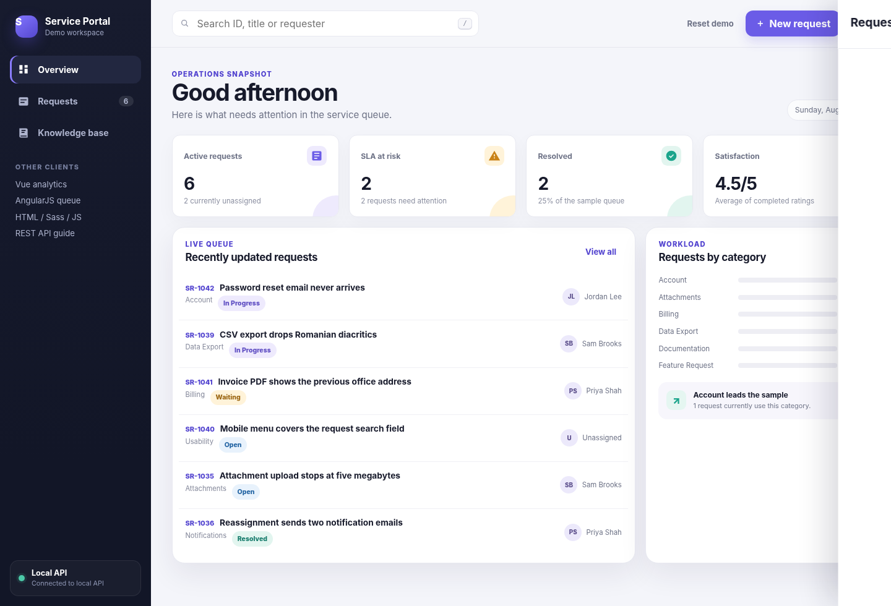
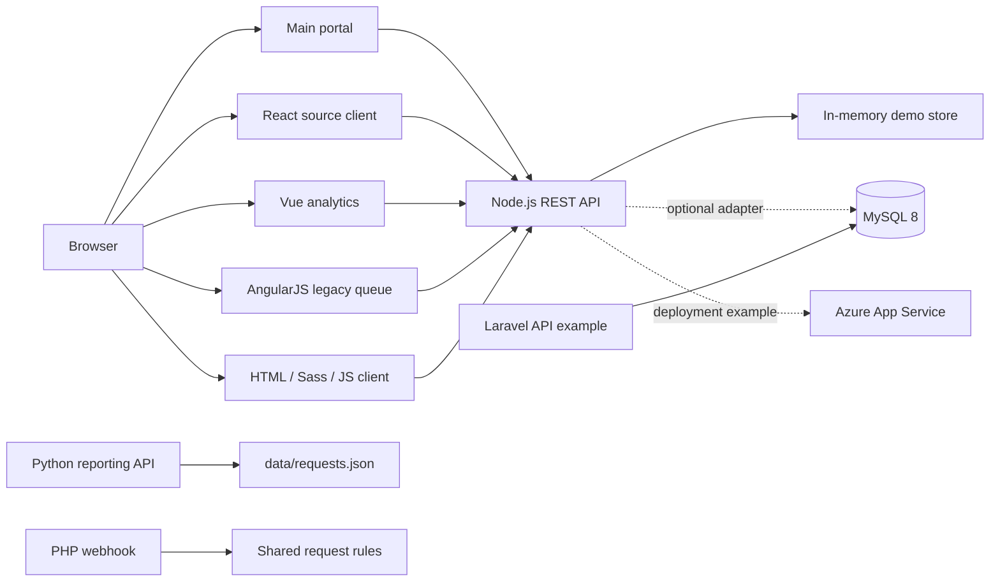

# Service Request Platform

A practical full-stack development workspace built around one coherent product: a service-request portal for creating, triaging and reporting on incoming work.

The repository combines beginner and intermediate web-development topics without pretending that every framework is part of one production runtime. The default application is deliberately easy to run, while the additional clients, backends, database model and deployment files show how the same domain can be approached with different tools.



## Run the main application

**Requirement:** Node.js 22 or newer. No database, cloud account or paid service is required.

```bash
node dist/server/src/server.js
```

Open `http://127.0.0.1:4174`.

Convenience launchers are also included:

```text
Windows:        scripts\run_windows.cmd
macOS / Linux:  ./scripts/run_unix.sh
```

The compiled server is checked in so the preview works immediately after extraction. After changing TypeScript source, install the development dependencies and rebuild:

```bash
npm install
npm run build
npm start
```

## Available application surfaces

| URL | Purpose | Main technologies |
|---|---|---|
| `/` | Complete interactive portal | HTML, CSS, JavaScript, Node.js REST API |
| `/vue/` | Read-only analytics dashboard | Vue 3 |
| `/angularjs/` | Legacy triage client | AngularJS 1.8 |
| `/fundamentals/` | No-framework client | Semantic HTML, Sass source, JavaScript DOM APIs |
| `/api-docs.html` | Human-readable API guide | HTML, OpenAPI links |
| `/api/openapi.json` | Machine-readable contract | OpenAPI 3.1 |

The full React + TypeScript + Bootstrap + Sass client is in `apps/react-client`. It is kept as source rather than replacing the zero-install preview.

## What is included

### Frontend

- Semantic HTML, responsive CSS, CSS custom properties and accessible form patterns.
- Modular Sass examples with tokens, layout and component partials.
- Modern JavaScript using Fetch, DOM APIs, array methods, modules and local storage.
- TypeScript models and API clients.
- React component architecture, hooks, forms, filtering and Bootstrap utilities.
- Vue 3 Composition API analytics client.
- AngularJS controller/service example isolated as a legacy-maintenance client.

### Backend and data

- Dependency-free Node.js HTTP server written in TypeScript.
- REST endpoints with validation, structured errors, security headers and request IDs.
- Python/FastAPI reporting service with pure reporting functions and tests.
- Standalone PHP webhook endpoint with reusable validation.
- Laravel 12 API implementation with Form Requests, Resources, migrations, factories and feature tests.
- Normalized MySQL 8 schema, deterministic seed data, views and useful queries.
- Optional MySQL repository adapter demonstrating parameterized queries and transactions.

### Delivery and operations

- Dockerfile and optional Docker Compose MySQL profile.
- Laragon setup notes and Procfile examples for Windows learners.
- Azure App Service infrastructure expressed in Bicep.
- Azure Pipelines and GitHub Actions examples.
- Postman collection and environment files.
- OpenAPI JSON and YAML contracts.

## Architecture



The default server uses deterministic in-memory data so it cannot fail because a database is absent. MySQL is an explicit optional path, not a hidden runtime requirement.

## Repository map

```text
api/                         OpenAPI and Postman assets
apps/
  react-client/              React + TypeScript + Bootstrap + Sass
  vue-dashboard/             Vue 3 + TypeScript analytics client
  angularjs-admin/           AngularJS 1.8 controller/service client
  fundamentals/              HTML + Sass + JavaScript source client
data/                        Deterministic JSON fixtures
database/mysql/              Schema, seed, views and queries
docs/                        Architecture, setup and testing notes
infra/azure/                 Bicep App Service deployment
public/                      Ready-to-run browser application
server/src/                  TypeScript Node API
services/
  laravel-api/               Laravel API alternative
  php-webhook/               Plain PHP endpoint
  python-reporting/          FastAPI reporting service
tests/                       Node API and Playwright tests
```

## API examples

```bash
curl http://127.0.0.1:4174/api/health
curl "http://127.0.0.1:4174/api/requests?priority=High"
```

Create a request:

```bash
curl -X POST http://127.0.0.1:4174/api/requests \
  -H "Content-Type: application/json" \
  -d '{
    "title": "Exported report is missing the owner column",
    "description": "The monthly CSV omits the owner column for resolved requests.",
    "category": "Data Export",
    "priority": "Medium",
    "requester": {
      "name": "Alex Morgan",
      "email": "alex.morgan@example.test"
    },
    "tags": ["csv", "reporting"]
  }'
```

## Quality checks

Install development dependencies once, then run the complete core gate:

```bash
npm install
npm run qa
```

The gate rebuilds the TypeScript server, validates repository structure and JSON assets, checks JavaScript and PHP syntax, runs the Node API tests, exercises the standalone PHP validator and runs the Python reporting tests.

Browser tests are separate because Playwright needs a browser download:

```bash
npx playwright install chromium
npm run test:e2e
```

More detail is available in [docs/testing.md](docs/testing.md).

## Optional development paths

- [React client](apps/react-client/README.md)
- [Vue client](apps/vue-dashboard/README.md)
- [AngularJS client](apps/angularjs-admin/README.md)
- [Python reporting service](services/python-reporting/README.md)
- [PHP webhook](services/php-webhook/README.md)
- [Laravel API](services/laravel-api/README.md)
- [MySQL model](database/mysql/README.md)
- [Laragon setup](docs/laragon-setup.md)
- [Azure deployment](infra/azure/README.md)

## Scope and deliberate limitations

This is a study and portfolio project, not a claim that all included technologies should run together in production.

- Authentication and authorization are not implemented. The sample users are fixtures only.
- The default Node server stores changes in memory and resets when it restarts.
- MySQL, Laravel, Python and PHP are independent examples sharing the same business domain.
- The AngularJS client is intentionally marked as legacy because official AngularJS support ended in January 2022.
- Azure files are deployment examples; no subscription, resource or secret is included.
- Production concerns such as centralized identity, rate limiting, durable queues and managed secrets remain outside this repository's scope.

These boundaries keep the local experience free, predictable and reviewable.

## Documentation

- [Architecture](docs/architecture.md)
- [Technology map](docs/stack-map.md)
- [Local development](docs/local-development.md)
- [API contract](docs/api-contract.md)
- [Testing strategy](docs/testing.md)
- [Accessibility notes](docs/accessibility.md)
- [Deployment options](docs/deployment.md)
- [Architecture decisions](docs/decisions/0001-one-domain-multiple-implementations.md)

## License

MIT. See [LICENSE](LICENSE).
