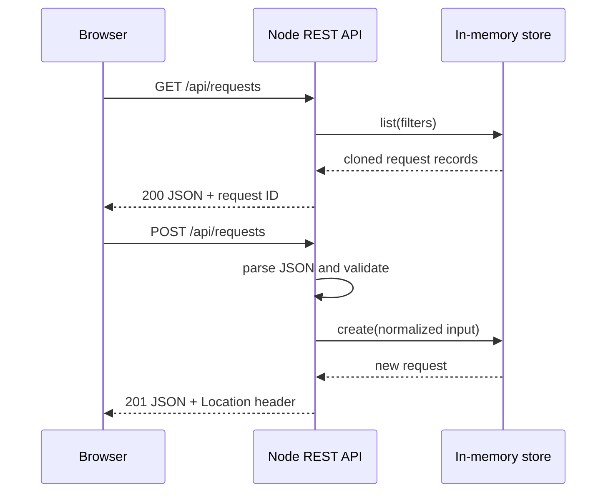

# Architecture

## Goals

The project is designed to be:

- runnable without a database, cloud account or paid subscription;
- understandable to someone learning full-stack development;
- broad enough to demonstrate several common frontend and backend approaches;
- honest about which parts are primary, optional or illustrative;
- testable at the API, browser and pure-function levels.

## Runtime architecture

The default runtime has two parts:

1. Static files in `public/` provide the browser interface.
2. A dependency-free Node.js server in `server/src/` serves those files and exposes the REST API.

The API reads fixture data once at startup, clones it into an in-memory store and applies changes there. Restarting the process restores the checked-in sample state. The `POST /api/demo/reset` endpoint restores the same state without a restart.

## Server modules

| Module | Responsibility |
|---|---|
| `server.ts` | Routing, CORS, request IDs and HTTP status selection |
| `validation.ts` | Boundary validation and normalization |
| `store.ts` | In-memory CRUD operations and defensive cloning |
| `metrics.ts` | Deterministic queue metrics |
| `http-utils.ts` | JSON parsing, error envelopes and security headers |
| `static.ts` | MIME types, HEAD support and path-safe static delivery |
| `mysql-store.ts` | Optional normalized MySQL repository example |

The server has no external runtime dependency. This is intentional: the first-run experience remains predictable, and framework-specific learning remains isolated in the application folders.

## Multiple clients, one contract

Each frontend consumes the same API vocabulary:

- requests have the same status, priority and category values;
- list filters use query-string parameters;
- validation failures use one structured error envelope;
- workflow updates use `PATCH` rather than replacing the full record.

The clients are alternatives, not a micro-frontend composition:

- the checked-in `public/` portal is the ready-to-run reference;
- the React client demonstrates a component-based operational workspace;
- the Vue client concentrates on computed reporting views;
- the AngularJS client demonstrates maintenance of a legacy controller/service application;
- the fundamentals client keeps the same behavior visible without framework abstractions.

## Data choices

The in-memory model is the default because it has no setup cost. `database/mysql` provides a normalized durable design with separate users, requests, tags, comments and knowledge articles.

The optional MySQL adapter uses:

- placeholders for all external values;
- a field allowlist for workflow updates;
- transactions for multi-table writes;
- public IDs separate from numeric database keys;
- explicit mapping from SQL rows to API records.

It is not activated by default. Connecting it would require a real `mysql2` connection and a deliberate storage selection in the server bootstrap.

## Alternate backend examples

The additional backend folders are purposefully narrower than the main Node API:

- **Python/FastAPI** exposes reporting endpoints and keeps calculations in pure functions.
- **Plain PHP** validates a webhook payload and returns a stable acceptance response.
- **Laravel** shows framework conventions for CRUD endpoints, validation, resources, migrations and feature tests.

This separation avoids a misleading architecture where several languages write to the same local state without coordination.

## Security posture

Included controls:

- one-megabyte JSON body limit;
- explicit enum validation;
- HTML escaping in the browser-rendered templates;
- parameterized SQL in the optional adapter;
- request correlation IDs;
- content-type sniffing protection;
- frame denial, referrer policy and permissions policy;
- a Content Security Policy appropriate to the local sample;
- no credentials or tokens in the repository.

Not included:

- authentication or authorization;
- rate limiting;
- distributed audit logs;
- managed secrets;
- production data retention or privacy controls.

Those are deployment requirements rather than hidden claims of this sample.
